# DhwaniKavach AI (ध्वनिकवच) — Industrial Acoustic Armor & Machine Diagnostic Platform

<div align="center">


<p align="center">
  <strong>An Unsupervised Deep Learning Acoustic Anomaly Detection & Predictive Maintenance (PdM) System for Industrial Assets.</strong>
  <br />
  <em>Trained exclusively on healthy machine acoustics to flag mechanical faults, bearing degradation, cavitation, and structural resonance without requiring labeled failure datasets.</em>
</p>

[System Overview](#-system-overview) •
[High-Level Architecture](#-high-level-architecture) •
[Industrial Diagnostic Engine](#-industrial-diagnostic-engine) •
[Quickstart](#-quickstart-guide) •
[REST API Reference](#-rest-api-reference) •
[Production Roadmap](#-future-roadmap--enterprise-recommendations)

</div>

---

## 📖 System Overview

In heavy manufacturing, machines rarely operate in a failed state, making failure data scarce and severely imbalanced. Traditional supervised classification models fail in real-world factories because they cannot anticipate unseen failure modes.

**DhwaniKavach AI (ध्वनिकवच)** resolves this zero-failure dilemma through **unsupervised acoustic reconstruction**:
1. **Audio to Spectral Image:** Converts raw equipment audio into 64-band Mel-Spectrograms ($16\text{ kHz}$ sampling rate).
2. **Normal Baseline Encoding:** A Convolutional Autoencoder (CAE) learns the compact latent distribution of healthy mechanical signatures.
3. **Reconstruction & Loss Computation:** Unfamiliar acoustic patterns (friction, rattling, cavitation, bearing spall) cannot be reconstructed by the decoder, causing a surge in Mean Squared Error (MSE).
4. **Prescriptive Action Dispatch:** An ISO 10816-inspired multi-band diagnostic engine localizes the failure in the frequency spectrum and triggers automated industrial alerts (MQTT / Webhooks).

---

## 🏛️ High-Level Architecture

The end-to-end architecture is built on a modular pipeline designed for both central servers and low-latency edge gateways:

```mermaid
flowchart TD
    subgraph INGESTION["1. Acoustic Ingestion Layer"]
        A1["Industrial Acoustic Sensor / Mic Array"] -->|16kHz PCM Audio| A2["Stream Buffer / Audio Preprocessor"]
        A2 -->|Short-Time Fourier Transform| A3["64-Band Mel-Spectrogram (1x64x313)"]
    end

    subgraph CORE_AI["2. Deep Learning Core (CAE)"]
        A3 --> B1["Encoder (Conv2D + MaxPool)"]
        B1 --> B2["Latent Bottleneck (64x8x39)"]
        B2 --> B3["Decoder (ConvTranspose2D)"]
        B3 --> B4["Reconstructed Mel-Spectrogram"]
    end

    subgraph DIAGNOSTICS["3. Industrial Diagnostic & Decision Engine"]
        A3 & B4 --> C1["Pixel-wise Residual Calculation: |Input - Recon|²"]
        C1 --> C2["Global MSE vs Dynamic Threshold"]
        C1 --> C3["Multi-Band Spectral Split"]
        C3 -->|0 - 600 Hz| D1["Low Band: Unbalance / Looseness"]
        C3 -->|600 - 2500 Hz| D2["Mid Band: Gear Mesh / Cavitation"]
        C3 -->|2.5k - 8000 Hz| D3["High Band: Bearing Spall / Friction"]
        C2 & D1 & D2 & D3 --> E1["ISO 10816 Severity Classification (Normal / Warning / Critical)"]
    end

    subgraph DEPLOYMENT["4. Edge & Integration Layer"]
        E1 --> F1["Glassmorphism Web Dashboard"]
        E1 --> F2["Edge ONNX Runtime Engine (<15ms)"]
        E1 --> F3["IIoT Telemetry Dispatcher (MQTT / Webhooks / ISO-55000 Log)"]
    end

    style INGESTION fill:#0f172a,stroke:#38bdf8,stroke-width:1px
    style CORE_AI fill:#0f172a,stroke:#7c5cfc,stroke-width:1px
    style DIAGNOSTICS fill:#0f172a,stroke:#00d4aa,stroke-width:1px
    style DEPLOYMENT fill:#0f172a,stroke:#f59e0b,stroke-width:1px
```



---

## ⚙️ Industrial Diagnostic Engine (ISO 10816 Inspired)

Instead of outputting an opaque numeric loss, **DhwaniKavach AI** maps acoustic errors into industrial severity levels and frequency root-causes:

| Severity Level | Threshold Condition | Color Code | Prescriptive Maintenance Action |
| :--- | :--- | :--- | :--- |
| **NORMAL (Class A/B)** | $\text{MSE} \le \text{Threshold}$ | `Emerald Green` | Routine monitoring. Asset operating within healthy parameters. |
| **WARNING (Class C)** | $\text{Threshold} < \text{MSE} \le 1.35 \times \text{Threshold}$ | `Amber Warning` | Scheduled inspection. Acoustic deviation detected in dominant frequency band. |
| **CRITICAL (Class D)** | $\text{MSE} > 1.75 \times \text{Threshold}$ | `Crimson Alert` | Immediate shutdown or intervention. High-energy harmonic or bearing failure imminent. |

### Frequency Band Isolation & Diagnostics:
* **Low Frequency Band (0 – 600 Hz):** Identifies shaft misalignment, structural mounting looseness, and fundamental rotational unbalance.
* **Mid Frequency Band (600 – 2500 Hz):** Identifies gear meshing defects, pump impeller cavitation, and valve flutter.
* **High Frequency Band (2500 – 8000 Hz):** Identifies rolling element bearing raceway spalling, lubrication breakdown, and high-frequency metal-to-metal rubbing.

---

## 🌟 Key Features

* **Zero-Failure Supervised Bias Elimination:** Trains solely on normal operational acoustics. Never requires pre-recorded failure sounds.
* **Dynamic Baseline Calibration:** Statistical ($\mu + 3\sigma$) and percentile calibration engine that adapts thresholds to varying plant background acoustics at runtime.
* **Edge Optimized with ONNX:** One-click ONNX export pipeline with dynamic axes support for sub-15ms edge inference on Raspberry Pi 5 or NVIDIA Jetson.
* **Explainable AI (XAI) Spectral Residuals:** Color-coded 2D heatmap showing exact time-frequency coordinates where the machine deviates from normal operation.
* **Robust Data Augmentation:** Features **SpecAugment** (time and frequency masking) and Gaussian noise injection to prevent model overfitting to ambient factory hum.
* **Industrial Telemetry Dispatcher:** Emits standardized telemetry to MQTT topics (`factory/telemetry/{asset_id}/fault`), webhooks (Slack/Teams), and ISO-55000 audit logs.

---

## 📂 Project Repository Structure

```text
DhwaniKavach_AI/
├── checkpoints/             # Trained neural network weights (.pth, .onnx)
│   ├── best_autoencoder.pth # Best checkpoint model weights
│   └── calibration.json     # Saved dynamic baseline parameters
├── dashboard/               # Flask Web Application & Presentation Layer
│   ├── static/              # Dark Glassmorphism CSS and Vanilla JS
│   ├── templates/           # HTML5 UI templates (index.html)
│   └── app.py               # Application factory & REST API endpoints
├── meta/                    # Dataset metadata and class definitions
├── outputs/                 # Evaluation graphs and industrial audit logs
├── scripts/                 # CLI entry points
│   ├── dashboard.py         # Launch local monitoring server
│   ├── generate_spectrograms.py # Preprocessing pipeline
│   ├── train.py             # Model training script
│   └── tune_hyperparams.py  # Optuna hyperparameter ablation study
├── src/                     # Core Deep Learning & Diagnostic Logic
│   ├── config.py            # Global paths, constants, and hyperparameters
│   ├── data/
│   │   ├── loader.py        # PyTorch Dataset, SpecAugment & Noise transforms
│   │   └── preprocessing.py # Audio to Mel-Spectrogram tensor transforms
│   ├── inference/
│   │   ├── alerts.py        # MQTT / Webhook industrial alert dispatcher
│   │   ├── calibration.py   # Statistical dynamic threshold calibration
│   │   ├── diagnostics.py   # Multi-band ISO 10816 diagnostic engine
│   │   ├── edge_onnx.py     # ONNX runtime edge predictor & exporter
│   │   └── predict.py       # Inference pipeline
│   └── models/
│       └── autoencoder.py   # Convolutional AutoEncoder architecture
├── Procfile                 # Cloud web app entry point (Render / Railway)
├── requirements.txt         # Project dependencies
└── README.md                # Technical documentation
```

---

## 🚀 Quickstart Guide

### 1. Prerequisites
* Python 3.10, 3.11, or 3.12
* Windows, Linux, or macOS
* Microphone (optional, for live acoustic monitoring)

### 2. Installation
```bash
# Clone the repository
git clone https://github.com/your-username/DhwaniKavach-AI.git
cd DhwaniKavach-AI

# Install required dependencies
python -m pip install -r requirements.txt
```

### 3. Launch the Live Dashboard
```bash
python scripts/dashboard.py
```
Open **`http://127.0.0.1:5000`** in your browser to access the live monitoring suite.

---

## 📡 REST API Reference

| Endpoint | Method | Payload / Form | Description |
| :--- | :--- | :--- | :--- |
| `/api/health` | `GET` | None | Returns server health, model parameter count, active threshold, and edge status. |
| `/api/predict` | `POST` | `audio` (File), `threshold` (Optional float) | Performs inference, returns ISO severity, multi-band errors, prescriptive action, and spectrogram images. |
| `/api/predict-batch` | `POST` | `audio` (Multiple files) | Batch classification and fleet status aggregation. |
| `/api/calibrate` | `POST` | `{"losses": [...], "method": "sigma", "k": 3.0}` | Dynamically re-calibrates active threshold from baseline samples. |
| `/api/export-onnx` | `POST` | None | Exports PyTorch model to ONNX format for Edge Runtime deployment. |

---

## 🌐 Cloud & Production Deployment

### Option A: Render / Railway (PaaS)
This repository includes a preconfigured [Procfile](file:///e:/Machine_Sound_Diagnostic-main%20%281%29/Machine_Sound_Diagnostic-main/Procfile).
1. Push this repository to GitHub.
2. Link the repository to **Render** or **Railway**.
3. It will automatically detect the `Procfile` and launch via `gunicorn`:
   ```bash
   gunicorn -w 2 -b 0.0.0.0:$PORT "dashboard.app:create_app()" --timeout 120
   ```

### Option B: Docker Container
```dockerfile
FROM python:3.12-slim
WORKDIR /app
RUN apt-get update && apt-get install -y libsndfile1 && rm -rf /var/lib/apt/lists/*
COPY requirements.txt .
RUN pip install --no-cache-dir -r requirements.txt
COPY . .
EXPOSE 5000
CMD ["gunicorn", "-w", "2", "-b", "0.0.0.0:5000", "dashboard.app:create_app()"]
```

---

## 🔮 Future Roadmap & Enterprise Recommendations

To further scale **DhwaniKavach AI** into a full enterprise-grade industrial monitoring suite:

1. **Industrial Dataset Migration:**
   * Transition from general environmental audio (ESC-50) to the **MIMII Dataset** (Malfunctioning Industrial Machines) and **ToyADMOS2** for pump, valve, fan, and slide-rail benchmarks.
2. **Beamforming & Sensor Arrays:**
   * Implement Delay-and-Sum beamforming with multi-channel MEMS microphone arrays to isolate a single motor from surrounding plant noise.
3. **Continuous Sliding-Window Audio Streaming:**
   * Upgrade one-off audio clip upload to continuous real-time sliding WebSocket audio streams with rolling anomaly time-series tracking.
4. **OPC-UA & SCADA Native Drivers:**
   * Add native industrial PLC communication modules (OPC-UA / Modbus TCP) to automatically trigger motor shut-off circuits on critical alarms.
5. **Edge Hardware Acceleration:**
   * Quantize exported ONNX models to INT8 using TensorRT or OpenVINO for sub-5ms inference on micro-edge gateways.

---

## 📄 License & Attribution

This project is licensed under the MIT License — see the [LICENSE](LICENSE) file for details.  
Built with PyTorch, Flask, and the open-source Machine Learning community.
